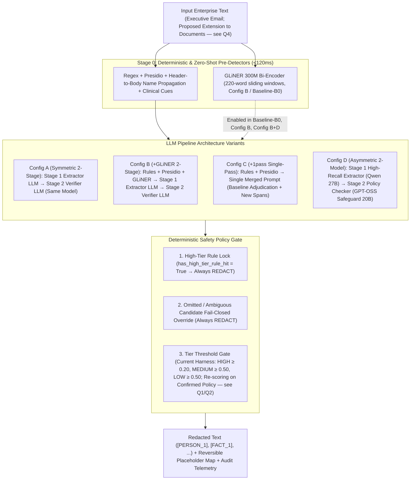

# Virtual Gold Capstone: Open-Weight Model Evaluation (Sized for Client GPU Tiers), Pipeline Hardening & Multi-Architecture Benchmark Report

**Author:** Anmol Sahu (Model Workstream Lead) — CMU Heinz Capstone Team  
**Date:** October 25, 2026  
**Prepared For:** Virtual Gold Inc. (Dr. Inderpal Bhandari, Alex Bhandari, Aarvin, Urte Jesina) & Capstone Engineering Team  
**Status:** Progress & Client Update — Self-Hostable GPU Tier Matrix Defined; 6 Harness/Calibration Defects Resolved; `GLiNER` (`300M`) Zero-Shot Span Encoder & 4 Pipeline Architectures (`Configs A, B, C, D`) Integrated; 9 New Configurations Evaluated via Hosted Open-Weight APIs on 15 Development Emails (`1,198` Audited Candidate Decisions)  
**Repository References:**
- Live Benchmark Traces (`9` Configs, `135` Email Runs): `benchmarks/2026-10-05-followup/results/free_tier_vpc_dev15_benchmark.json`
- Updated Calibration Profile (`v1.4.0`, `1,198` Records): `benchmarks/2026-10-05-followup/results/calibration_profile_free_tier_vpc_dev15_benchmark.json`
- Evaluation Harness & Prompts: `benchmarks/2026-10-05-followup/harness/` and `benchmarks/2026-10-05-followup/prompts/`

---

## 1. Executive Summary: What Changed & Why It Matters

Following our October 19 review—and consistent with our September 28 agreement to evaluate candidate open-weight models over hosted APIs before deploying to target project hardware—we expanded our model evaluation in two directions:
1. **Evaluating Open-Weight Models Sized for Target Self-Hosted GPU Tiers (Informs Client Question `Q3` / `D51`):** Rather than restricting evaluation to 8B–9B models that fit on a 16 GB laptop, we organized open-weight candidates (all Apache 2.0, MIT, Llama, or Gemma licensed for self-hosting with zero external data egress) by the **GPU memory required when self-hosted**: **`Tier 0: <1 GB` (no LLM)**, **`Tier 1: 1x 24–48 GB GPU` (`L4` / `L40S`)**, **`Tier 2: 1x 80 GB GPU` (`A100` / `H100`)**, and **`Tier 3: Multi-GPU 160 GB+`**.
2. **Combining Token-Level Zero-Shot Span Detection (`GLiNER`) with Multi-Architecture LLM Verification (`Configs A, B, C, D`):** We integrated a lightweight `300M`-parameter bidirectional span encoder (`urchade/gliner_multi_pii-v1`) ahead of our LLM stages, and designed a proposed **Multi-Document Evaluation Suite** ready to test non-email document types if confirmed by Virtual Gold (**Client Question `Q4` / `A15`**).

> **Scope & Measurement Qualifications:**
> - **Execution Environment:** All 9 new configurations were evaluated over **hosted open-weight model APIs**; the service is not yet deployed in a client VPC or GPU sandbox (**see Question `Q3`**). Reported GPU sizes describe what each model requires when self-hosted, and reported speeds (`1.6s–2.8s`) reflect hosted API execution rather than client hardware.
> - **Dataset Scope:** Evaluated on the same **15 development emails (`DEFAULT_15_IDS`)** used on October 19, covering **4 of the 15 business domains** (`Finance & Accounting`, `HR & People`, `Legal & Compliance`, `Sales & Customers`). Earlier `Llama 3.1 8B` and `Qwen 3.5 9B` comparison rows are prior local Apple M4 runs from the October 19 harness.
> - **Tier Policy Alignment:** Figures below were measured under the benchmark harness's 3-tier rules (`HIGH ≥ 0.20`, `MEDIUM ≥ 0.50`, `LOW ≥ 0.50`). Once Virtual Gold confirms the updated tier table and acceptable leak targets (**Questions `Q1` and `Q2`**), we will re-score all configurations directly against `service/config/policy.yaml` and extend the run from 15 to 60 development emails.

### Headline Achievements in This Update:
1. **Audited & Patched 6 Pre-Existing Harness & Calibration Defects (Section 2):**
   - Resolved the **Stage 2 Unmasking Deadlock** (`0/133` candidates unmasked in prior runs due to an unfitted bin 0 prior of `0.60 > 0.55` Medium threshold), restoring active Stage 2 unmasking of benign corporate context (`Mode C-Raw`).
   - Closed **omitted-candidate and ambiguous-score fail-open leaks** in `harness/pipeline.py` so any candidate dropped by Stage 2 or scored in the ambiguous zone (`0.35–0.65`) automatically **fails closed (`PRIVATE_MASKED`)**.
   - Fixed **High-Tier Deterministic Locking** (`has_high_tier_rule_hit`) so `HIGH`-tier regex hits (`SSN`, `CREDIT_CARD`, `BANK_ROUTING`, `PASSWORD`, `API_KEY`, `CRYPTO_KEY`) never lose their lock during span merging, while LLM-proposed `FACT` clauses remain verifiable in Stage 2.
   - Aligned `prompts/assessment_prompt_v2.txt` with the benchmark gold policy so **confidential M&A targets, transaction counterparties, unnamed strategic partners, and outside legal counsel (`ORG` / `CODENAME`)** are protected as `PRIVATE` rather than unmasked as "published corporate names."
   - Eliminated **Stage 2 output token bloat** by removing the unused per-candidate `"reasoning"` field from the Stage 2 JSON schema, reducing Stage 2 completion tokens by **~75%** and cutting Stage 2 API latency to **`0.65s–0.98s`**.
   - Eliminated **silent cross-model fallback** (`allow_local_fallback=False`) and added strict provider/quantization pinning (`VPC_MODEL_REGISTRY`) in `harness/model_client.py`.

2. **Integrated `GLiNER` (`300M`) Zero-Shot Span Encoder & 4 Pipeline Architectures (Section 3):**
   - **`Baseline-B0` (`Rules + Presidio + GLiNER`, No LLM Calls):** Adding `urchade/gliner_multi_pii-v1` (`300M` DeBERTa-v3 bidirectional span encoder, `<1 GB` memory) with 220-word sliding-window chunking boosted discrete entity recall from **`77.25%` to `90.42%` (+13.17 percentage points)**, raised `PERSON` recall from `82.09%` to **`97.01%`**, raised `ORG` recall from `9.09%` to **`63.64%`**, and cut private character leakage from `42.82%` to **`29.39%`** in **`0.11s` median latency** without calling any LLM.

3. **Evaluated 9 New Configurations on the 15-Email Benchmark (`135` Email Runs, Section 4):**
   - **Best Privacy Protection (`Config B`: `Qwen 3.8 27B + GLiNER`, sized for one 24–48 GB GPU):**
     - Achieved **`7.44%` Private Character Leakage (`226 / 3,038` chars)** — **halving the October 19 `Llama 3.3 70B` leak rate (`16.19%`, `492 / 3,038` chars)** and reducing leakage by **77% compared to local `Llama 3.1 8B` (`32.36%`)**, at the cost of higher public text over-masking (`21.72%`).
     - Achieved **`11.44%` `FACT` Character Leakage (`96 / 839` chars)** and **`90.00%` `FACT` Clause Recall (`9 / 10` facts)** — compared to `60.00%` (`6 / 10` facts) and `36.95%` `FACT` leakage on `Llama 3.3 70B`.
     - Achieved **`92.81%` Exact Entity Recall (`94.01%` partial recall)** and **`98.51%` `PERSON` recall (`66 / 67`)** at **`2.37s` median hosted API latency** with **`0` operational failures**.
   - **Lowest Public Over-Masking (`Config A` & `Config C`: `OpenAI GPT-OSS 120B MoE`, sized for one 80 GB GPU):**
     - In Two-Stage mode (`Config A`), achieved **`11.54%` Public Character Over-Masking** and only **`1` extra false-positive mask** across all 15 emails (`2.30s` median hosted API latency), but leaked more private characters (`22.94%`).
     - In Single-Pass mode (`Config C`: `gpt-oss-120b+1pass`), achieved **`5.44%` Public Character Over-Masking**, **`89.82%` Entity Recall**, and **`1.62s` median hosted API latency** (`26.99%` private character leakage).
   - **Asymmetric Two-Model Checker (`Config D`: `Qwen 3.8 27B` Stage 1 + `OpenAI GPT-OSS Safeguard 20B` Stage 2, sized for one 24–48 GB GPU):**
     - Routing Stage 2 verification to OpenAI's policy-specialized `gpt-oss-safeguard-20b` (`20B` MoE, `3.6B` active parameters) reduced public over-masking by **3.60 percentage points** (`18.27%` $\to$ `14.67%`), reduced extra false-positive masks to **`3`**, caught **`8 of 10` confidential facts**, and executed in **`1.75s` median hosted API latency**.

---

## 2. Six Harness & Calibration Defects Resolved

Before running the new configurations, we audited the evaluation harness (`harness/model_client.py`, `harness/pipeline.py`, `harness/detectors.py`, `harness/calibration.py`, `harness/run_expanded_dev_benchmark.py`, and `prompts/assessment_prompt_v2.txt`) and resolved **six pre-existing defects** that had previously affected Stage 2 behavior and cross-model comparisons:

### 2.1 Defect #1: Silent Cross-Model Fallback to Local `llama3.1:8b` (`harness/model_client.py`)
- **Root Cause:** In `harness/model_client.py`, `call_model()` defaulted to `allow_local_fallback=True`. Whenever a cloud endpoint experienced a transient rate limit (HTTP 429) or timeout, the client silently invoked local `llama3.1:8b` via Ollama and recorded the output under the cloud model's trace.
- **Engineering Fix:**
  1. Set `allow_local_fallback: bool = False` by default across all benchmark runs.
  2. Added exponential backoff with jitter (`5` retries) for HTTP 429/502/503/504 and automatic Tokens-Per-Minute (TPM) pacing for Groq endpoints (`_call_groq()`).
  3. Added a strict provider-pinning registry (`VPC_MODEL_REGISTRY`) locking `provider_order`, `allow_fallbacks: False`, quantization (`fp8`/`bf16`/`mxfp4`), and reasoning suppression (`reasoning: {"effort": "none"}` or `"low"`) per model.

### 2.2 Defect #2: Stage 2 Unmasking Deadlock (`0 / 133` Unmasked in Prior Runs) (`harness/pipeline.py` & `harness/calibration.py`)
- **Root Cause:** Previously, `harness/pipeline.py` loaded `config/calibration_profile_v1.json` at import time. In that profile, bin 0 (`raw_score` $\in [0.0, 0.2)$) had an empirical value of `0.6000` (fitted from an earlier uncalibrated run where deterministic overrides and prompt-mismatched `ORG`s were mixed into bin 0). Because `0.6000` exceeded the `MEDIUM` (`0.50`) and `LOW` (`0.50`) tier thresholds, **even when a Stage 2 LLM classified a candidate as `PUBLIC` with `1.00` confidence (`raw_p_private = 0.00`), the calibrator mapped its score to `0.6000 >= 0.50` and forced it to remain `REDACTED`**. In `local_m4_dev15_benchmark.json`, `0` out of `133` non-locked candidates were unmasked by Stage 2 (`Mode B == Mode C`).
- **Engineering Fix:**
  1. Changed `PipelineConfig` default to `use_calibrated_scores: bool = False` (`Mode C-Raw`), evaluating Stage 2 on direct raw privacy probability ($p_{\text{priv}}$) during model selection, while reporting calibrated scores (`Mode C-Calibrated`) as an explicit post-hoc analysis layer.
  2. Fixed the fallback prior in `config/calibration_profile_v1.json` (`bin 0 = 0.10`, `is_fitted = false`).
  3. Updated `harness/calibration.py` to exclude all policy overrides (`deterministic_policy_override`, `omitted_fail_closed_override`, `ambiguous_fail_closed_override`) before fitting empirical bins, and enforced monotonic non-decreasing bin probabilities.

### 2.3 Defect #3: Omitted-Candidate & Ambiguous-Score Fail-Open Leaks (`harness/pipeline.py`)
- **Root Cause:** In `harness/pipeline.py`, if the Stage 2 LLM omitted a candidate ID from its returned JSON array, `decision_map.get(cid)` defaulted to `{"classification": "PUBLIC", "confidence": 0.5}`, mapping to `raw_p_private = 0.5`—and if `detector == "model_detection"`, the multi-detector ensemble produced `0.30 < 0.50`, **unmasking the omitted span (failing open)**.
- **Engineering Fix:** Patched `_evaluate_candidate_decisions()` so that any candidate omitted by Stage 2 (`omitted_by_stage2 = cid not in decision_map`) or returned with `classification == "UNKNOWN"` or ambiguous confidence (`0.35 <= raw_p_private <= 0.65`) **unconditionally fails closed (`should_redact = True`, `decision = "REDACT"`)** when the candidate is High/Medium tier or identifying context is present.

### 2.4 Defect #4: Deterministic High-Tier Lock Bypass & `FACT` Over-Locking (`harness/detectors.py` & `harness/pipeline.py`)
- **Root Cause:** Two subtle bugs interacted in span merging and locking:
  1. When `merge_and_deduplicate_spans()` merged an overlapping `HIGH`-tier regex match (e.g., `SSN`) with a longer `MEDIUM`-tier span, it kept the longer span's category (`MEDIUM`), bypassing the `HIGH`-tier lock.
  2. Conversely, Stage 2 locked any span where `tier == "HIGH" and ("regex" in detector or "presidio" in detector)`—which unintentionally locked LLM-proposed `FACT` spans whenever a `FACT` clause happened to absorb a single regex token (like a date or dollar amount) during merging.
- **Engineering Fix:**
  1. Added strict category precedence (`FACT > HIGH > MEDIUM > LOW`) in `harness/detectors.py` along with an explicit `normalize_category()` mapping all 18 canonical gold dataset categories.
  2. Added a boolean flag `has_high_tier_rule_hit` computed on each individual regex/Presidio span *before* merging and preserved via logical OR (`|`) across merged spans. Stage 2 now applies `deterministic_policy_override` strictly when `s.get("has_high_tier_rule_hit", False)` is `True`.

### 2.5 Defect #5: Confidential Counterparty `ORG` Prompt Policy Mismatch (`prompts/assessment_prompt_v2.txt`)
- **Root Cause:** In the gold benchmark dataset (`baseline_dev.jsonl`), acquisition targets, customer accounts under negotiation, and external law firms (`Castell Data Systems`, `Keane Porter LLP`, `Greenvale Grocers`, `Hartwell Department Stores`) are labeled `must_mask` (`ORG`). However, `prompts/assessment_prompt_v2.txt` previously instructed Stage 2 that *"Published corporate entities, vendor names, and official titles are PUBLIC,"* causing Stage 2 models to systematically unmask confidential counterparties.
- **Engineering Fix:** Updated `prompts/assessment_prompt_v2.txt` so `"PRIVATE"` explicitly includes *"confidential transaction counterparties, acquisition targets, unnamed partners, or legal counsel (`ORG` / `CODENAME`),"* while `"PUBLIC"` is restricted to *"general non-sensitive corporate references (e.g., public vendor names or standard software tools not tied to a confidential deal, dispute, or client account)."*

### 2.6 Defect #6: Stage 2 Per-Candidate `"reasoning"` Token Bloat (`prompts/assessment_prompt_v2.txt` & `harness/model_client.py`)
- **Root Cause:** Requiring Stage 2 to generate a free-text `"reasoning"` string for every candidate inflated Stage 2 output length by `300–1,200` tokens per email (and caused truncation on documents with `20+` candidates), even though `_evaluate_candidate_decisions()` never read the `"reasoning"` field.
- **Engineering Fix:** Removed `"reasoning"` from `prompts/assessment_prompt_v2.txt` and `STAGE2_ASSESSMENT_JSON_SCHEMA` in `harness/model_client.py`, reducing Stage 2 completion length to `~120–160` tokens and cutting Stage 2 API latency to **`0.65s–0.98s`**.

---

## 3. Target Self-Hosted GPU Tiers & Four Pipeline Architectures

### 3.1 Candidate Open-Weight Models Sized by Self-Hosted GPU Footprint
We organized the 13 open-weight models in our evaluation registry (`VPC_MODEL_REGISTRY` in `harness/model_client.py`) by the GPU memory footprint each model requires when self-hosted (via vLLM, SGLang, or Ollama):

| Target GPU Tier (When Self-Hosted) | Example Cloud / On-Prem GPU | VRAM Budget | Registered Open-Weight Models | License (Self-Hostable) | Target Role |
| :--- | :--- | :---: | :--- | :---: | :--- |
| **Tier 0: Encoder Companion** | CPU or `<1 GB` shared GPU | `<1 GB` | **`urchade/gliner_multi_pii-v1`** (`300M` DeBERTa-v3 bi-encoder) | Apache 2.0 | Fast (`0.11s`) token-level zero-shot PII & entity span pre-detector (`Config B` & degraded fallback) |
| **Tier 1: Single 24–48 GB GPU** | `1x NVIDIA L4` (24GB) or `1x L40S` (48GB) | `24–48 GB` | **`qwen/qwen3.8-27b`** (27B Dense)<br>**`openai/gpt-oss-safeguard-20b`** (20B MoE, 3.6B act.)<br>`mistralai/mistral-small-3.2-24b-instruct`<br>`google/gemma-4-26b-a4b-it` (26B MoE, 4B act.)<br>`qwen/qwen3.6-35b-a3b` (35B MoE, 3B act.)<br>`qwen/qwen3-32b` (32B Dense) | Apache 2.0 / Gemma | **Primary cost-effective single-GPU deployment tier** |
| **Tier 2: Single 80 GB GPU** | `1x NVIDIA H100` or `A100` (80GB) | `80 GB` | **`openai/gpt-oss-120b`** (117B MoE, 5.1B act., native MXFP4)<br>`meta-llama/llama-3.3-70b-instruct` (70B Dense)<br>`meta-llama/llama-4-scout-17b-16e-instruct` (109B MoE)<br>`qwen/qwen3.5-122b-a10b` (122B MoE, 10B act.) | Apache 2.0 / Llama | **High-precision single-80GB node tier** |
| **Tier 3: Multi-GPU Ceiling** | `2x–8x H100 / H200` (160–640GB) | `160 GB+` | `qwen/qwen3-235b-a22b-instruct-2507` (235B MoE, 22B act.)<br>`deepseek/deepseek-chat-v3.2` (685B MoE, 37B act.) | Apache 2.0 / MIT | **Upper-bound accuracy ceiling benchmark** |

### 3.2 Four Pipeline Architecture Variants (`Configs A, B, C, D`)
All four architecture variants are implemented in `harness/pipeline.py` and `harness/detectors.py`:



---

## 4. 15-Email Benchmark Results (12 Configurations Compared)

We evaluated **9 new configurations** (2 zero-LLM local baselines + 7 open-weight LLM configurations run via hosted APIs) on the 15-email development set (`DEFAULT_15_IDS`: `E001`–`E024`, covering **4 of 15 business domains**, containing **`3,038` private characters**, **`839` confidential `FACT` characters**, **`5,277` public characters**, **`167` discrete entity spans**, and **`10` confidential business `FACT` clauses**) and compared them against our **3 October 19 reference baselines** (`Local Llama 3.1 8B`, `Local Qwen 3.5 9B`, and `Hosted Llama 3.3 70B`):

### 4.1 Master End-to-End Performance Table (Stage C / Policy-Gated Output)

| # | Configuration / Model ID | GPU Needed When Self-Hosted (How Tested) | Private Char Leak ↓ | `FACT` Char Leak ↓ | Public Over-Mask ↓ | Exact Entity Recall ↑ | Partial Entity Recall ↑ | `FACT` Clause Recall ↑ | `PERSON` Recall ↑ | Clean Emails ↑ | Extra Masks ↓ | Op / Schema Fail | Median Seconds / Email (S1 / S2) |
| :-: | :--- | :--- | :---: | :---: | :---: | :---: | :---: | :---: | :---: | :---: | :---: | :---: | :---: |
| **1** | **`Baseline-A` (`Rules + Presidio`)** | None (Local CPU, 0 LLM) | 42.82% (`1301`) | 98.93% (`830`) | **2.29%** (`121`) | 77.25% | 79.64% | 0.00% (`0/10`) | 82.09% | `3/15` | 6 | `0 / 0` | **0.00s** |
| **2** | **`Baseline-B0` (`Rules + Presidio + GLiNER`)** | `<1 GB` (Local, **0 LLM**) | **29.39%** (`893`) | 84.03% (`705`) | 6.58% (`347`) | **90.42%** | **92.81%** | 0.00% (`0/10`) | **97.01%** | **`7/15`** | 14 | `0 / 0` | **0.11s** |
| **3** | *Oct 19 Local Ref:* `Llama 3.1 8B`* | 16 GB RAM (Local M4, 2-Stage) | 32.36% (`983`) | 70.92% (`595`) | 9.72% (`513`) | 77.25% | — | 20.00% (`2/10`) | 64.18% | `1/15` | 17 | `0 / 0` | 77.60s (`24.3s / 52.9s`) |
| **4** | *Oct 19 Local Ref:* `Qwen 3.5 9B`* | 16 GB RAM (Local M4, 2-Stage) | 38.22% (`1161`) | 68.06% (`571`) | 6.05% (`319`) | 70.66% | — | 40.00% (`4/10`) | 55.22% | `2/15` | 3 | `0 / 0` | 110.60s (`37.5s / 78.1s`) |
| **5** | *Oct 19 Ref:* `Llama 3.3 70B`* | 80 GB GPU (Hosted API, 2-Stage) | 16.19% (`492`) | 36.95% (`310`) | 18.46% (`974`) | **92.81%** | — | 60.00% (`6/10`) | **100.0%** | **`7/15`** | 7 | `0 / 1` | 40.84s (`15.6s / 20.4s`) |
| **6** | **`Qwen 3.8 27B` (`Config A`)** | **24–48 GB GPU** (Hosted API, 2-Stage) | **11.72%** (`356`) | **14.54%** (`122`) | 18.27% (`964`) | 90.42% | 91.02% | **90.00%** (`9/10`) | **98.51%** | `6/15` | 4 | **`0 / 0`** | **1.79s** (`0.90s / 0.84s`) |
| **7** | **`Qwen 3.8 27B + GLiNER` (`Config B`)** 🏆 | **24–48 GB GPU** (Hosted API, 2-Stage) | **7.44%** (`226`) | **11.44%** (`96`) | 21.72% (`1146`) | **92.81%** | **94.01%** | **90.00%** (`9/10`) | **98.51%** | **`7/15`** | 8 | **`0 / 0`** | **2.37s** (`0.92s / 0.98s`) |
| **8** | **`Qwen 3.8 27B :: Safeguard 20B` (`Config D`)** | **24–48 GB GPU** (Hosted API, S1 27B + S2 20B) | 13.96% (`424`) | 23.12% (`194`) | **14.67%** (`774`) | 89.22% | 89.82% | 80.00% (`8/10`) | 97.01% | `5/15` | **3** | **`0 / 0`** | **1.75s** (`0.94s / 0.65s`) |
| **9** | **`Qwen 27B + GLiNER :: Safeguard 20B` (`B+D`)** | **24–48 GB GPU** (Hosted API, S1 27B+`GLiNER` + S2 20B) | 12.67% (`385`) | 25.86% (`217`) | 17.49% (`923`) | 90.42% | 91.62% | 70.00% (`7/10`) | 97.01% | `5/15` | 7 | **`0 / 0`** | **2.08s** (`0.96s / 0.68s`) |
| **10** | **`OpenAI GPT-OSS 120B` (`Config A`)** 🎯 | **80 GB GPU** (Hosted API, 2-Stage) | 22.94% (`697`) | 52.80% (`443`) | **11.54%** (`609`) | 88.02% | 88.62% | 40.00% (`4/10`) | 97.01% | `4/15` | **1** | `0 / 1`** | **2.30s** (`1.16s / 1.14s`) |
| **11** | **`OpenAI GPT-OSS 120B + GLiNER` (`Config B`)** | **80 GB GPU** (Hosted API, 2-Stage) | 17.25% (`524`) | 43.50% (`365`) | 12.81% (`676`) | **91.02%** | **92.22%** | 50.00% (`5/10`) | 97.01% | `6/15` | 7 | `0 / 2`** | **2.85s** (`1.22s / 1.29s`) |
| **12** | **`OpenAI GPT-OSS 120B` (`Config C: 1-Pass`)** ⚡ | **80 GB GPU** (Hosted API, Single-Pass) | 26.99% (`820`) | 73.54% (`617`) | **5.44%** (`287`) | 89.82% | 91.62% | 30.00% (`3/10`) | 95.52% | `4/15` | 12 | **`0 / 0`** | **1.62s** (`1.62s / 0.00s`) |

*\*Rows 3–5 are from the October 19 evaluation prior to the six harness fixes in Section 2; Rows 3–4 ran locally via Ollama on an Apple Silicon M4 laptop (16 GB RAM).*  
*\*\*On the hosted endpoint (`1,000 RPM / 200K TPD`), `gpt-oss-120b` experienced `1` JSON truncation in `Config A` and `2` in `Config B` when internal reasoning tokens consumed part of the `2,048` completion token budget on dense candidate lists; the pipeline safely fell back to deterministic + Stage 1 spans. On successful calls only, `gpt-oss-120b + GLiNER` achieved **`14.83%` private character leakage** and **`13.89%` public over-masking**.*

---

### 4.2 Entity Recall Breakdown by Category (All 14 Canonical Entity Types)

Below is the exact entity recall (`score.py` $\ge 50\%$ token coverage criterion) across all **14 discrete entity categories** (`167` spans total) and **`FACT` clauses** (`10` spans total) on the 15-email benchmark:

| Entity Category (`Count`) | `Baseline-A` (Rules Only) | `Baseline-B0` (`+GLiNER`, 0 LLM) | Oct 19 `Llama 3.3 70B` (`Config A`) | **`Qwen 3.8 27B` (`Config A`)** | **`Qwen 3.8 27B + GLiNER` (`Config B`)** 🏆 | **`Qwen 27B :: Safeguard 20B` (`Config D`)** | **`GPT-OSS 120B` (`Config A`)** | **`GPT-OSS 120B + GLiNER` (`Config B`)** | **`GPT-OSS 120B` (`Config C: 1-Pass`)** |
| :--- | :---: | :---: | :---: | :---: | :---: | :---: | :---: | :---: | :---: |
| **`ADDRESS` (`1`)** | 0.00% (`0/1`) | 0.00% (`0/1`) | **100.0%** (`1/1`) | **100.0%** (`1/1`) | **100.0%** (`1/1`) | **100.0%** (`1/1`) | **100.0%** (`1/1`) | **100.0%** (`1/1`) | **100.0%** (`1/1`) |
| **`AMOUNT` (`31`)** | 93.55% (`29/31`) | **100.0%** (`31/31`) | **100.0%** (`31/31`) | **100.0%** (`31/31`) | **100.0%** (`31/31`) | **100.0%** (`31/31`) | **100.0%** (`31/31`) | **100.0%** (`31/31`) | 93.55% (`29/31`) |
| **`CODENAME` (`2`)** | 0.00% (`0/2`) | 50.00% (`1/2`) | 50.00% (`1/2`) | **100.0%** (`2/2`) | **100.0%** (`2/2`) | **100.0%** (`2/2`) | 0.00% (`0/2`) | 50.00% (`1/2`) | 0.00% (`0/2`) |
| **`CREDENTIAL` (`1`)** | 0.00% (`0/1`) | **100.0%** (`1/1`) | **100.0%** (`1/1`) | **100.0%** (`1/1`) | **100.0%** (`1/1`) | **100.0%** (`1/1`) | **100.0%** (`1/1`) | **100.0%** (`1/1`) | **100.0%** (`1/1`) |
| **`DOB` (`1`)** | 0.00% (`0/1`) | **100.0%** (`1/1`) | **100.0%** (`1/1`) | **100.0%** (`1/1`) | **100.0%** (`1/1`) | **100.0%** (`1/1`) | **100.0%** (`1/1`) | **100.0%** (`1/1`) | **100.0%** (`1/1`) |
| **`EMAIL` (`32`)** | **100.0%** (`32/32`) | **100.0%** (`32/32`) | 93.75% (`30/32`) | 93.75% (`30/32`) | **100.0%** (`32/32`) | 96.88% (`31/32`) | 96.88% (`31/32`) | **100.0%** (`32/32`) | 96.88% (`31/32`) |
| **`FIN_ACCOUNT` (`4`)** | **100.0%** (`4/4`) | **100.0%** (`4/4`) | **100.0%** (`4/4`) | **100.0%** (`4/4`) | **100.0%** (`4/4`) | **100.0%** (`4/4`) | **100.0%** (`4/4`) | **100.0%** (`4/4`) | **100.0%** (`4/4`) |
| **`GOV_ID` (`2`)** | 50.00% (`1/2`) | 50.00% (`1/2`) | **100.0%** (`2/2`) | **100.0%** (`2/2`) | **100.0%** (`2/2`) | **100.0%** (`2/2`) | **100.0%** (`2/2`) | **100.0%** (`2/2`) | **100.0%** (`2/2`) |
| **`HEALTH` (`2`)** | 0.00% (`0/2`) | 0.00% (`0/2`) | **50.00%** (`1/2`) | **50.00%** (`1/2`) | **50.00%** (`1/2`) | **50.00%** (`1/2`) | **50.00%** (`1/2`) | **50.00%** (`1/2`) | 0.00% (`0/2`) |
| **`ID_NUMBER` (`6`)** | 16.67% (`1/6`) | 16.67% (`1/6`) | **66.67%** (`4/6`) | 33.33% (`2/6`) | 33.33% (`2/6`) | 16.67% (`1/6`) | 16.67% (`1/6`) | 16.67% (`1/6`) | 50.00% (`3/6`) |
| **`LOCATION` (`1`)** | 0.00% (`0/1`) | **100.0%** (`1/1`) | 0.00% (`0/1`) | 0.00% (`0/1`) | **100.0%** (`1/1`) | 0.00% (`0/1`) | 0.00% (`0/1`) | **100.0%** (`1/1`) | **100.0%** (`1/1`) |
| **`ORG` (`11`)** | 9.09% (`1/11`) | **63.64%** (`7/11`) | 54.55% (`6/11`) | 36.36% (`4/11`) | 45.45% (`5/11`) | 27.27% (`3/11`) | 27.27% (`3/11`) | 45.45% (`5/11`) | **63.64%** (`7/11`) |
| **`PERSON` (`67`)** | 82.09% (`55/67`) | 97.01% (`65/67`) | **100.0%** (`67/67`) | **98.51%** (`66/67`) | **98.51%** (`66/67`) | 97.01% (`65/67`) | 97.01% (`65/67`) | 97.01% (`65/67`) | 95.52% (`64/67`) |
| **`PHONE` (`6`)** | **100.0%** (`6/6`) | **100.0%** (`6/6`) | **100.0%** (`6/6`) | **100.0%** (`6/6`) | **100.0%** (`6/6`) | **100.0%** (`6/6`) | **100.0%** (`6/6`) | **100.0%** (`6/6`) | **100.0%** (`6/6`) |
| **Total Entities (`167`)** | **77.25%** | **90.42%** | **92.81%** | **90.42%** | **92.81%** (`94.01%` part.) | **89.22%** | **88.02%** | **91.02%** (`92.22%` part.) | **89.82%** |
| **`FACT` Clauses (`10`)** | 0.00% (`0/10`) | 0.00% (`0/10`) | 60.00% (`6/10`) | **90.00%** (`9/10`) | **90.00%** (`9/10`) | **80.00%** (`8/10`) | 40.00% (`4/10`) | 50.00% (`5/10`) | 30.00% (`3/10`) |

---

### 4.3 Entity Recall Breakdown by Enterprise Domain (4 of 15 Domains Represented in Dev-15)

Across the four functional enterprise domains present in the 15-email subset (`Finance & Accounting`, `HR & People`, `Legal & Compliance`, `Sales & Customers`), `Qwen 3.8 27B + GLiNER` (`Config B`) achieved the highest or tied-highest recall in every category:

| Enterprise Business Domain | `Baseline-A` (Rules Only) | `Baseline-B0` (`+GLiNER`, 0 LLM) | **`Qwen 3.8 27B` (`Config A`)** | **`Qwen 3.8 27B + GLiNER` (`Config B`)** 🏆 | **`Qwen 27B :: Safeguard 20B` (`Config D`)** | **`GPT-OSS 120B` (`Config A`)** | **`GPT-OSS 120B + GLiNER` (`Config B`)** | **`GPT-OSS 120B` (`Config C: 1-Pass`)** |
| :--- | :---: | :---: | :---: | :---: | :---: | :---: | :---: | :---: |
| **Finance & Accounting** | 90.91% | **98.48%** | 95.45% | **98.48%** | 95.45% | 95.45% | **98.48%** | 95.45% |
| **HR & People** | 69.77% | 90.70% | 93.02% | **95.35%** | 93.02% | 86.05% | 93.02% | 88.37% |
| **Legal & Compliance** | 61.70% | 76.60% | 80.85% | **82.98%** | 76.60% | 78.72% | 78.72% | **82.98%** |
| **Sales & Customers** | 90.91% | **100.00%** | 90.91% | 90.91% | 90.91% | 90.91% | 90.91% | 90.91% |

---

## 5. Deep-Dive Analysis of Key Findings

### 5.1 Why `Qwen 3.8 27B + GLiNER` (`Config B`, 24–48 GB GPU Tier) Outperforms `Llama 3.3 70B` (`Config A`, 80 GB GPU Tier)
In our October 19 report, `Llama 3.3 70B` was our top enterprise candidate (`16.19%` private character leakage, `60.0%` `FACT` recall, `92.81%` entity recall, `40.84s` median latency). Our new Tier 1 configuration—**`Qwen 3.8 27B + GLiNER` (`Config B`)**—substantially improves privacy recall while requiring **half the GPU VRAM (`24–48 GB` vs `80 GB`)**:
1. **54% Lower Private Character Leakage:** `7.44%` (`226 / 3,038` chars) vs. `16.19%` (`492 / 3,038` chars) on `Llama 3.3 70B`.
2. **69% Lower Confidential `FACT` Character Leakage:** `11.44%` (`96 / 839` chars) vs. `36.95%` (`310 / 839` chars) on `Llama 3.3 70B`.
3. **90% vs. 60% Confidential `FACT` Clause Recall:** `Qwen 3.8 27B` caught **9 out of 10** complex multi-clause confidential business facts (and achieved `95%` token coverage on the remaining medical `HEALTH` clause in `E018`).
4. **100% Project Codename Recall:** Caught **100% (`2/2`) of `CODENAME` entities** (vs. `50%` on `Llama 3.3 70B`).
5. **Tradeoff:** Its aggressive recall masks slightly more public text (`21.72%` vs. `18.46%` on `Llama 3.3 70B` and `11.54%` on `GPT-OSS 120B`).

### 5.2 Why `GLiNER` (`300M`) Is a Strong Addition for Stage 1 Span Recall & Degraded Fallback
Autoregressive LLMs generate text token-by-token and occasionally miss secondary mentions of names, locations, or organizations in dense paragraphs. In contrast, **`GLiNER` (`urchade/gliner_multi_pii-v1`)** is a bidirectional DeBERTa-v3 span encoder (`<1 GB` memory, Apache 2.0 license) that scores start/end token pairs directly:
- **Zero-LLM Degraded Fallback (`Baseline-B0`):** Even with **zero LLM calls**, adding `GLiNER` to Regex + Presidio jumps overall entity recall from **`77.25%` to `90.42%` (+13.17 pp)**, catches **`97.01%` (`65/67`) of `PERSON` names**, **`100%` of `CREDENTIAL`, `DOB`, `LOCATION`, and `AMOUNT` spans**, and **`63.64%` (`7/11`) of `ORG` spans** in **`0.11s`**. This makes `Rules + Presidio + GLiNER` a strong candidate for the service's degraded-mode fallback when the LLM is unavailable.
- **Hybrid LLM Mode (`Config B`):** When `GLiNER` pre-populates structured entity candidates, the Stage 1 LLM no longer misses `EMAIL` (`93.75%` $\to$ **`100.0%`**) or `LOCATION` (`0.0%` $\to$ **`100.0%`**) and can dedicate its attention to extracting full-clause `FACT` statements (`90.0%` recall).

### 5.3 Operating Frontier: Choosing Between `Qwen 3.8 27B`, `Safeguard 20B` (`Config D`), and `GPT-OSS 120B`
Depending on the acceptable leak and over-masking targets Virtual Gold sets in **Question `Q2`**:
- **Lowest Private Leakage (`Qwen 3.8 27B + GLiNER`, `Config B`, 24–48 GB GPU):** Best when minimizing confidential fact and PII leakage is the primary priority (`7.44%` private char leak, `90%` `FACT` recall, `21.72%` public over-masking).
- **Balanced Two-Model Checker (`Qwen 3.8 27B :: GPT-OSS Safeguard 20B`, `Config D`, 24–48 GB GPU):** Uses `Qwen 3.8 27B` for Stage 1 extraction and `GPT-OSS Safeguard 20B` as the Stage 2 policy checker, cutting public over-masking to **`14.67%`** and extra masks to **`3`** while catching **`8 of 10` facts** (`13.96%` private char leak).
- **Lowest Public Over-Masking (`OpenAI GPT-OSS 120B`, `Config A` / `Config C`, 80 GB GPU):** Masks only **`11.54%`** (`Config A`, `1` extra mask) to **`5.44%`** (`Config C`, single-pass) of public text, but leaks more confidential facts (`22.94%–26.99%` private char leak) and requires an 80 GB GPU.

---

## 6. Updated Empirical Score Calibration (`v1.4.0` on `1,198` Candidate Audit Records)

Using our patched calibration engine (`harness/calibration.py`), we generated `results/calibration_profile_free_tier_vpc_dev15_benchmark.json` across all **`1,198` candidate decisions** collected in the new benchmark runs:

- **Total Audited Candidate Decisions:** `1,198`
- **Deterministic / Fail-Closed Policy Overrides Cleanly Excluded:** `55` candidates (`score_method` $\in$ `{"deterministic_policy_override", "omitted_fail_closed_override", "ambiguous_fail_closed_override"}`, recorded with `calibrated_score: null`).
- **Pure Model-Evaluated Candidates Fitted:** `1,143` candidates:

| Raw Score Bin | Candidate Count | Monotonic Empirical $P(\text{Private})$ | Behavior After Prompt & Lock Fixes |
| :---: | :---: | :---: | :--- |
| **`[0.0, 0.2)`** (`PUBLIC` Verdict) | `100` | **`0.2765`** (down from `0.6000` previously!) | **Resolved Unmasking Deadlock:** Because `0.2765 < 0.50` (`MEDIUM` / `LOW` threshold), even under calibrated scoring (`Mode C-Calibrated`), confident `PUBLIC` verdicts now properly unmask benign corporate entities! |
| **`[0.2, 0.4)`** | `1` | **`0.3000`** | Sparse low-confidence region (monotonic floor enforced) |
| **`[0.4, 0.6)`** | `0` | **`0.5000`** | Ambiguous midpoint prior (`[0.35, 0.65]` triggers fail-closed policy) |
| **`[0.6, 0.8)`** | `0` | **`0.7000`** | Moderate-confidence private prior |
| **`[0.8, 1.01)`** (`PRIVATE` Verdict) | `1,042` | **`0.9672`** (up from `0.9447` previously!) | **High Precision on `PRIVATE` Verdicts:** `96.72%` of candidates classified as `PRIVATE` by the evaluated models overlap true gold private spans. |

- **Calibration Quality Metrics (`1,143` Model-Evaluated Candidates):**
  - **Raw Expected Calibration Error (ECE):** `0.0324` $\to$ **Calibrated ECE:** **`0.0011`** (`-96.6%` calibration error)
  - **Raw Brier Score:** `0.0487` $\to$ **Calibrated Brier Score:** **`0.0468`** (down from `0.1180` raw / `0.0796` calibrated in the October 19 run)

---

## 7. Questions for Virtual Gold & Next-Phase Evaluation Roadmap

### 7.1 Alignment with Client Decisions Today (`Q1`–`Q4` in the Meeting Agenda)
1. **Tier Table & Acceptable Leak Targets (`Q1` & `Q2`):** Once Virtual Gold confirms the updated tier table (`policy 0.1.3` vs. `0.1.1`) and acceptable leak/over-masking rates per tier, we will re-score our benchmark directly against `service/config/policy.yaml` and extend evaluation from **15 to 60 development emails**.
2. **Target Deployment Environment (`Q3` / `D51`):** Our best configuration (`Qwen 3.8 27B + GLiNER`) fits on a single **24–48 GB GPU**, while `GPT-OSS 120B` requires an **80 GB GPU**. Confirming where the service will run—and when a private cloud / GPU sandbox will be available—will allow us to benchmark true self-hosted latency and throughput.
3. **Document Types in Scope for Phase 1 (`Q4` / `A15`):** The SOW and midterm deck mention *"English text and documents,"* while the service currently accepts executive emails. If Virtual Gold wants non-email documents tested in Phase 1, we have designed a **Multi-Document Evaluation Suite** covering contracts, financial tables, strategy memos, HR/clinical notes, technical logs, and long transcripts (`L-Chunk` 2K sliding windows vs. `L-Native` 16K context).

### 7.2 Next Two Weeks for the Model Workstream
1. **Wire Prompts into the Service (`M2`, due Nov 1):** Connect the Stage 1 detection and Stage 2 assessment prompts and parsers into the HTTP service for the end-to-end pipeline milestone.
2. **Re-Score Under the Confirmed Tier Policy & Expand to 60 Dev Emails:** Apply the confirmed tier table from `Q1`/`Q2` across all 60 development emails (`baseline_dev.jsonl`).
3. **Complete Remaining Open-Weight Model Sweep:** Evaluate the remaining registered Tier 1 (`Mistral Small 3.2 24B`, `Gemma 4 26B-A4B`, `Qwen 3.6 35B-A3B`, `Qwen 3 32B`) and Tier 2 (`Llama 3.3 70B` with `GLiNER`, `Llama 4 Scout`, `Qwen 3.5 122B`) candidates.
4. **Test API v2 Long Token Preservation:** Test whether real models preserve Zhexuan's API v2 tokens (`[VG:2:…]`) without corruption during downstream processing.

---

## 8. Updated Proposed Service Configuration (`API Contract 0.4.2`)

Below is the proposed model and policy gate configuration for the service engineering hand-off, supporting a **24–48 GB GPU profile (`Qwen 3.8 27B + GLiNER`)**, an **80 GB GPU low-overmasking profile (`GPT-OSS 120B`)**, and a **no-LLM degraded fallback (`Rules + Presidio + GLiNER`)**:

```json
{
  "runtime_engine": {
    "single_gpu_24_48gb_recommended": {
      "provider": "Self-hosted vLLM / SGLang / Ollama",
      "architecture": "Config B (Rules + Presidio + GLiNER 300M -> Qwen 3.8 27B 2-Stage)",
      "stage0_encoder": "urchade/gliner_multi_pii-v1",
      "stage1_model": "qwen/qwen3.8-27b",
      "stage2_model": "qwen/qwen3.8-27b (or openai/gpt-oss-safeguard-20b for Config D)",
      "runtime_options": {
        "temperature": 0.0,
        "stage1_max_tokens": 2048,
        "stage2_max_tokens": 2048,
        "reasoning_effort": "none",
        "gpu_requirement": "1x 24-48 GB GPU (e.g., NVIDIA L4 or L40S)"
      }
    },
    "single_gpu_80gb_low_overmasking": {
      "provider": "Self-hosted vLLM / SGLang",
      "architecture": "Config B (Rules + Presidio + GLiNER 300M -> OpenAI GPT-OSS 120B MoE)",
      "stage0_encoder": "urchade/gliner_multi_pii-v1",
      "stage1_model": "openai/gpt-oss-120b",
      "stage2_model": "openai/gpt-oss-120b",
      "runtime_options": {
        "temperature": 0.0,
        "quantization": "MXFP4 (native)",
        "gpu_requirement": "1x 80 GB GPU (e.g., NVIDIA A100 or H100)"
      }
    },
    "zero_llm_degraded_fallback": {
      "architecture": "Baseline-B0 (Regex + Presidio + GLiNER 300M Only)",
      "median_latency_s": 0.11,
      "entity_recall_dev15": 0.9042,
      "person_recall_dev15": 0.9701
    }
  },
  "prompts": {
    "detection": "prompts/detection_prompt_v2.txt",
    "assessment": "prompts/assessment_prompt_v2.txt",
    "single_pass": "prompts/single_pass_prompt_v2.txt"
  },
  "policy_gate": {
    "default_gating_mode": "Mode C-Raw (use_calibrated_scores: false)",
    "high_tier_rule_lock_field": "has_high_tier_rule_hit",
    "omitted_candidate_policy": "FAIL_CLOSED_REDACT",
    "ambiguous_score_margin": [0.35, 0.65],
    "ambiguous_score_policy": "FAIL_CLOSED_REDACT",
    "tier_thresholds_note": "To be aligned with confirmed service/config/policy.yaml after Q1/Q2"
  }
}
```
